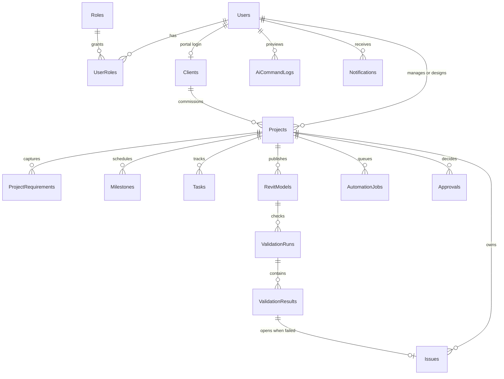

# Database

SQL Server 2019 or newer. Database name: `DesignFlowAI`.

## Restore the backup in SSMS

`DesignFlowAI.bak` is a full backup with schema, procedures, views, and sample data. Restore that file instead of running the numbered scripts.

1. Copy `DesignFlowAI.bak` to a folder the SQL Server service can read, such as `C:\Temp`. A default instance often cannot read a file under OneDrive or Desktop.
2. In SSMS, right-click **Databases** → **Restore Database**.
3. Select **Device**, add `DesignFlowAI.bak`, and confirm the destination name is `DesignFlowAI`.
4. On **Files**, point the data file and log at your instance’s data folder if SSMS reports the original path is missing. The backup was taken from LocalDB, so the original files are `C:\Users\HP\DesignFlowAI.mdf` and `C:\Users\HP\DesignFlowAI_log.ldf`.

Or run this in a query window after you change the two `MOVE` paths:

```sql
RESTORE DATABASE DesignFlowAI
FROM DISK = N'C:\Temp\DesignFlowAI.bak'
WITH MOVE N'DesignFlowAI' TO N'C:\Program Files\Microsoft SQL Server\MSSQL15.MSSQLSERVER\MSSQL\DATA\DesignFlowAI.mdf',
     MOVE N'DesignFlowAI_log' TO N'C:\Program Files\Microsoft SQL Server\MSSQL15.MSSQLSERVER\MSSQL\DATA\DesignFlowAI_log.ldf',
     REPLACE, RECOVERY;
```

Sample rows include 6 users, 3 clients, 3 projects, 9 tasks, 2 open validation issues, milestones, Revit models, and a pending AI task plan. Every sample login uses `DesignFlow123!`.

| Email | Role |
| --- | --- |
| `admin@designflow.ai` | Admin |
| `maya.chen@designflow.ai` | ProjectManager |
| `arjun.mehta@designflow.ai` | Designer |
| `lena.ortiz@designflow.ai` | Designer |
| `rahul.sharma@northwind.example` | Client |
| `sofia.alvarez@harborandco.example` | Client |

The numbered scripts below rebuild the same database from source if you do not want to restore the backup.

Scripts are idempotent. Run them in the order below. `run.ps1` does that for you.

## Execution order

| Step | Folder / file | What it does |
| --- | --- | --- |
| 0 | `000_create_database.sql` | Creates the database on `master` and turns on read-committed snapshot |
| 1 | `01_schema` | `CREATE TABLE`, one file per table, primary keys and defaults only |
| 2 | `02_constraints` | Foreign keys, indexes, unique constraints, check constraints |
| 3 | `03_stored_procedures` | Failed-validation workflow, approve / reject AI task plans |
| 4 | `04_views` | Dashboard, overdue tasks, open issues, validation pass rate |
| 5 | `05_seed_data` | Roles, users, clients, projects, tasks, a failed validation run |
| 6 | `06_migrations` | `V001__` baseline marker. Future deltas are `V002__`, `V003__`, … |

Do not run `06_migrations` as a substitute for steps 0–5. Migrations assume the baseline already exists.

## Run with PowerShell

From this folder:

```powershell
.\run.ps1 -Server "localhost"
```

LocalDB:

```powershell
.\run.ps1 -Server "(localdb)\MSSQLLocalDB"
```

SQL login:

```powershell
.\run.ps1 -Server "localhost" -User "sa" -Password "<your-local-password>"
```

## Run with sqlcmd

`000_create_database.sql` must run without `-d`. Every later file must target `DesignFlowAI`.

```powershell
sqlcmd -S localhost -E -b -i .\000_create_database.sql
sqlcmd -S localhost -E -b -d DesignFlowAI -i .\01_schema\001_Roles.sql
```

Repeat `-d DesignFlowAI` for each file, in the name order inside each numbered folder. `-b` makes `sqlcmd` fail on a SQL error.

## Verify

```powershell
sqlcmd -S localhost -E -d DesignFlowAI -Q "SELECT Code, Status, OpenIssueCount, OverdueTaskCount FROM dbo.vw_ProjectDashboard ORDER BY Code;"
sqlcmd -S localhost -E -d DesignFlowAI -Q "SELECT Title, Status, Source FROM dbo.Tasks WHERE Source = N'AiProposed';"
sqlcmd -S localhost -E -d DesignFlowAI -Q "SELECT Title, Severity, Status, AssignedToName FROM dbo.vw_OpenIssues;"
sqlcmd -S localhost -E -d DesignFlowAI -Q "SELECT PassRatePercent FROM dbo.vw_ValidationPassRate;"
```

After a fresh seed:

- `NW-2BHK-001` is `NeedsAttention` with two open issues assigned to Arjun Mehta. Those issues were inserted by `usp_CreateIssuesFromFailedValidation`, not by a hand-written `INSERT`.
- `HB-LOFT-014` has an overdue lighting task.
- Three Sharma tasks stay `Proposed` / `AiProposed`. They are absent from `vw_OverdueTasks`.
- Pass rate is 75 (6 passed checks, 2 failed).

To prove the approval gate locally, run this once. It promotes the three proposed tasks to `ToDo`:

```sql
EXEC dbo.usp_ApproveProposedTasks
    @ProjectId = 'D4000001-0000-4000-8000-000000000001',
    @ReviewerUserId = 'B2000001-0000-4000-8000-000000000002',
    @Comments = N'Approved in a local check.';
```

Re-running the seed will not put those tasks back to `Proposed`.

## Seed logins

`PasswordHash` is the placeholder `DEV_ONLY_NOT_A_REAL_HASH`. Phase 2 replaces it with an ASP.NET Identity hash for `DesignFlow123!`. That password is for a local database only.

| Email | Role |
| --- | --- |
| `admin@designflow.ai` | Admin |
| `maya.chen@designflow.ai` | ProjectManager |
| `arjun.mehta@designflow.ai` | Designer |
| `lena.ortiz@designflow.ai` | Designer |
| `rahul.sharma@northwind.example` | Client |
| `sofia.alvarez@harborandco.example` | Client |

## Stable keys

| Entity | Id |
| --- | --- |
| Sharma project `NW-2BHK-001` | `D4000001-0000-4000-8000-000000000001` |
| Failed validation run | `C9000001-0000-4000-8000-000000000001` |
| Maya Chen (project manager) | `B2000001-0000-4000-8000-000000000002` |
| Arjun Mehta (lead designer) | `B2000001-0000-4000-8000-000000000003` |

## Relationships


